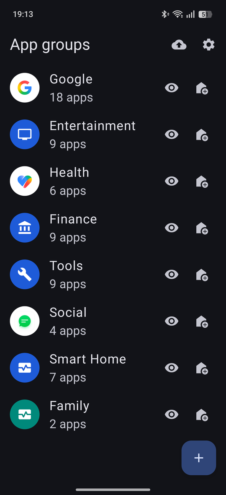
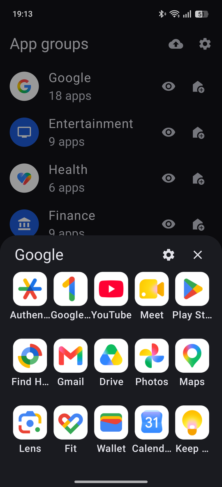
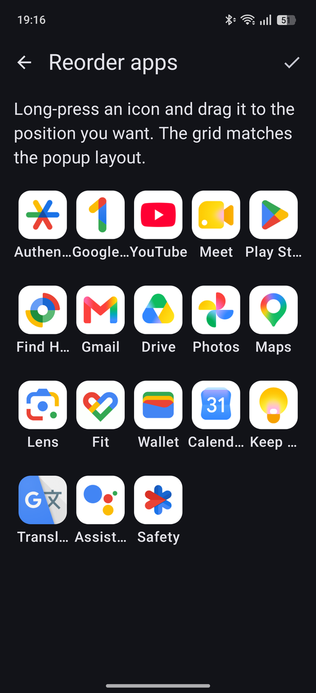
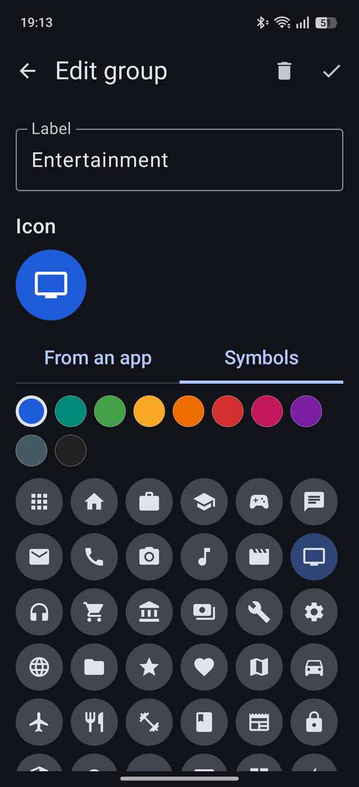
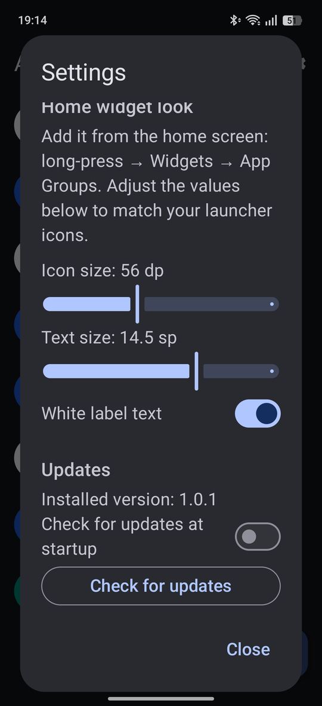

<div align="center">

# App Groups

**Group your Android apps into popups and open them from the home screen with a single tap.**

Create folders of apps that look and behave like any other launcher icon: a custom label, a custom icon, and a clean bottom-sheet popup with the apps you chose, in the order you chose.

[](https://github.com/armando-basile/AppGroups/actions/workflows/ci.yml)
[](https://github.com/armando-basile/AppGroups/releases/latest)
[](https://github.com/armando-basile/AppGroups/releases)
[](https://github.com/armando-basile/AppGroups/commits/main)


[**Download the latest APK**](https://github.com/armando-basile/AppGroups/releases/latest) · [Features](#features) · [Screenshots](#screenshots) · [Install](#install) · [Build from source](#build-from-source)

</div>

<p align="center">
  
  
  
</p>

## Why App Groups?

Launcher folders are great until you want the same tidy look *everywhere*: on every home screen page, with a label and icon you control, and without a heavy widget. App Groups gives each group of apps its own home screen icon and opens the apps in a fast popup.

- Fewer icons on your home screen, with the apps one tap away.
- One group per theme: work, banking, streaming, smart home, health, social, tools.
- Free to use, with no ads, no accounts, no analytics and no tracking. The only network access is the optional update check against this repository.

## Features

- **Unlimited groups** with your own **label** and **icon**.
- **Two kinds of icons**: use the icon of any installed app, or pick a symbol from the built-in Material icon set on a colour of your choice.
- **Popup with your apps** in a bottom sheet: choose 3, 4 or 5 columns and 3, 4 or 5 visible rows, then scroll for the rest.
- **Drag and drop ordering** to place every app exactly where you want it.
- **Preview** a group from the app before adding anything to the home screen.
- **Home screen widget (1x1)** that is drawn to look like a launcher icon and has **no corner badge**. Icon size and label size are adjustable to match your launcher.
- **Pinned shortcut** as an alternative when you need an icon where a widget can't go. Some launchers add a small app badge to shortcuts.
- **Backup and restore** to a folder you choose, or to any location offered by the system file picker, including **Google Drive**. The app remembers the file and updates it next time.
- **In-app updates** from GitHub Releases: check manually or at startup, with a SHA-256 and signature check before anything is installed.
- **Apps are read through the official launcher APIs**, which also cover other user profiles on the device.
- **Dark and light theme**, Material You dynamic colours, English and Italian.

## Screenshots

<table>
  <tr>
    <td align="center"><br><sub>Your groups</sub></td>
    <td align="center"><br><sub>The popup</sub></td>
    <td align="center"><br><sub>Label and icon</sub></td>
  </tr>
  <tr>
    <td align="center"><br><sub>Drag and drop ordering</sub></td>
    <td align="center"><br><sub>Settings and updates</sub></td>
    <td></td>
  </tr>
</table>

## Install

1. Download `AppGroups-vX.Y.Z.apk` from the [latest release](https://github.com/armando-basile/AppGroups/releases/latest).
2. Open it on your phone. Android asks you to allow installing apps from your browser or file manager: this is expected for apps that are not on Google Play.
3. Open **App Groups**, tap **+**, name the group, choose an icon and the apps, then save.

**Requirements:** Android 8.0 (API 26) or newer.

Each release also ships a `.sha256` file, so you can verify the download:

```bash
sha256sum -c AppGroups-vX.Y.Z.apk.sha256
```

### Add a group to the home screen

**Widget (recommended, no badge).** Long-press the home screen, open **Widgets**, find **App Groups**, drag the 1x1 widget to a free cell and pick the group. Open **Settings** in the app to match the icon and text size to your launcher.

**Pinned shortcut.** Tap the home icon next to the group in the list and confirm. On some devices you first have to allow *Home screen shortcuts* for the app in the system settings. Some launchers draw a small badge on pinned shortcuts: that is done by the launcher and cannot be turned off by the app.

### Updates

Open **Settings → Updates** to check for a new version, or turn on *Check for updates at startup*. When a newer release exists the app downloads it, verifies it and hands it to the system installer. Android asks once for the *Install unknown apps* permission.

### Backup and restore

Tap the cloud icon in the group list.

- **Local folder:** choose a folder once, then use **Back up now** and **Restore**.
- **File or Google Drive:** **Save to file** opens the system picker where you can choose Drive. Next time, **Update saved backup** overwrites the same file.

The backup is a single `AppGroupsConfigs.json` with groups, apps, order, icons and look settings. Home screen widgets are not part of it, so add them again after restoring on a new device.

## Compatibility

Developed and tested on a Realme GT 7T running Realme UI 7.0 (Android 16). It uses only public Android APIs, so it should work on other devices with Android 8.0 or newer, but behaviour of home screen widgets and pinned shortcuts depends on the launcher.

## Build from source

You need JDK 21 and the Android SDK (platform 36).

```bash
git clone https://github.com/armando-basile/AppGroups.git
cd AppGroups

# debug build
./gradlew assembleDebug

# unit tests and lint
./gradlew testDebugUnitTest lintDebug
```

Release builds are signed with a key read from the environment (`KEYSTORE_FILE`, `KEYSTORE_PASSWORD`, `KEY_ALIAS`, `KEY_PASSWORD`). Without them a local `assembleRelease` falls back to the debug key.

### Publishing a release

Pushing a tag like `v1.2.3` runs the [release workflow](.github/workflows/release.yml), which builds and signs the APK and publishes it with its checksum. The version name and code come from the tag, so no file needs to be edited.

```bash
git tag v1.2.3
git push origin v1.2.3
```

The repository needs these Actions secrets: `ANDROID_KEYSTORE_BASE64`, `ANDROID_KEYSTORE_PASSWORD`, `ANDROID_KEY_ALIAS` and `ANDROID_KEY_PASSWORD`. Keep the keystore safe: an app can only be updated by a build signed with the same key.

## Tech stack

Kotlin, Jetpack Compose with Material 3, `LauncherApps` and `ShortcutManager`, App Widgets, `PackageInstaller`, GitHub Actions.

## Contributing

Bug reports and ideas are welcome: please [open an issue](https://github.com/armando-basile/AppGroups/issues). Pull requests run the CI workflow (unit tests, lint and a debug build).

## Keywords

Android app folders, app groups, app launcher popup, home screen shortcuts, app drawer organizer, launcher folder widget, group apps on home screen.
